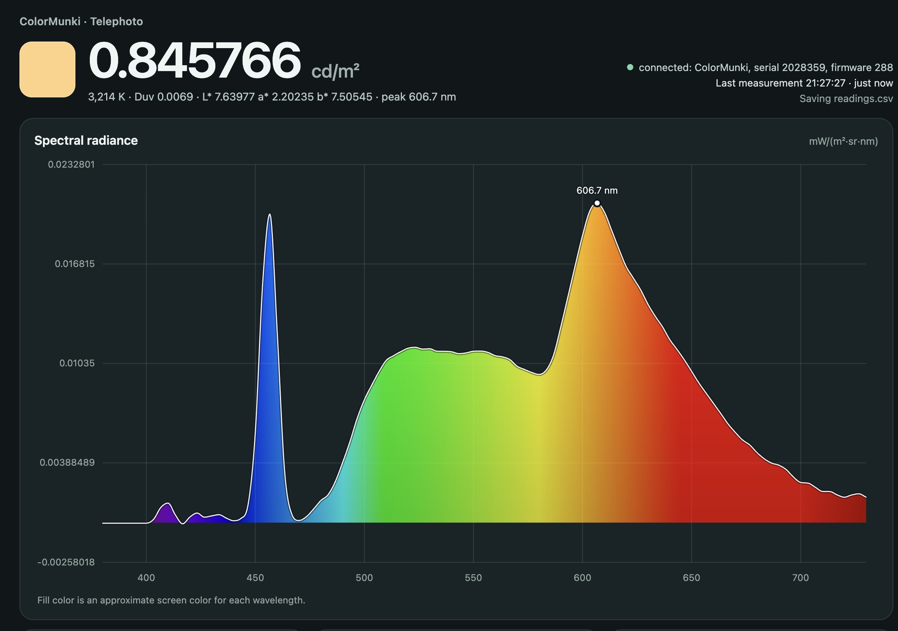
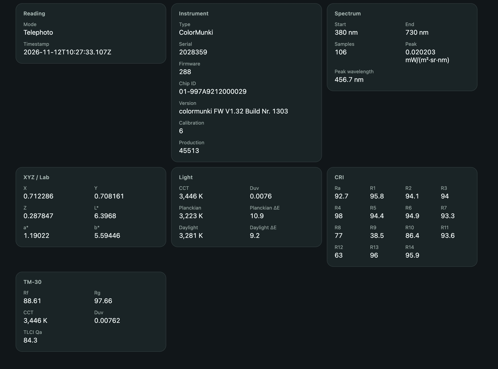

# spotread-logger

Polls a spectrometer or colorimeter through ArgyllCMS `spotread` and appends every reading to a CSV file, with a timestamp. With `--serve`, the same readings are also shown on a page on this computer. It has been used with an X-Rite ColorMunki. The parser reads `spotread`'s text, so another instrument that prints the same report can be logged the same way.





`spotread` is interactive: it may wait for a calibration key, then waits for a measurement key. This tool drives those prompts on a pseudo-terminal, asks you to set the instrument, then takes a reading on a timer. With `--no-calibration` it passes `-N`. When `spotread` still has a valid calibration it goes straight to measuring; when it asks anyway, the logger waits for the calibration step.

Each row stores the mode, instrument, spectrum, XYZ, and D50 Lab, plus whatever else that mode printed, such as lux, CCT, CRI, TM-30, or density. `nan` and a missing Planckian temperature become empty cells, and the original `spotread` text is left out. The spectrum is one JSON array from the reported start wavelength to the end. Reflectance samples are percents and reflectance XYZ is 0–100. The light modes store absolute spectral power, with XYZ in cd/m². Units are listed in the [spotread manual](https://www.argyllcms.com/doc/spotread.html).

## Install

Requires Python 3.11 or newer and ArgyllCMS `spotread` on your `PATH`.

ArgyllCMS builds and per-platform install notes, including the macOS USB setup, are at [argyllcms.com](https://www.argyllcms.com/). macOS binaries are on the [macOS download page](https://www.argyllcms.com/downloadmac.html). On macOS, Homebrew works too:

```bash
brew install argyll-cms
```

That formula provides `spotread`. This project was developed against ArgyllCMS 3.5.0 installed that way.

Run it from this directory. Python picks up the `spotread_logger` package on the path, so the project itself does not need to be installed. `pexpect` drives `spotread`. `aiohttp` serves the dashboard.

```bash
cd spotread-logger
python3 -m venv .venv
source .venv/bin/activate
pip install pexpect aiohttp
```

## Use

Put the instrument in the calibration position when asked. On a ColorMunki that is the calibration dial position. Press Enter, set it for the mode you chose, then press Enter again. Readings are appended after that until you press Ctrl-C.

| Mode | Default `spotread` arguments | Where the sensor goes |
| --- | --- | --- |
| `ambient` | `-a -H -s -v` | Ambient diffuser. Illuminance, CCT, CRI, TM-30. |
| `reflectance` | `-H -s -v -d` | Aperture down on the sample, so the instrument lamp lights it. Adds density. |
| `emissive` | `-e -H -s -v -T` | Open aperture aimed at a display or lamp. `-T` adds CCT, CRI, and TM-30. |
| `telephoto` | `-p -H -s -v -T` | Narrow aperture aimed at the source. On a ColorMunki this is the projector position. Same report shape as emissive. |

```bash
python -m spotread_logger --interval 30 --output readings.csv
python -m spotread_logger --mode reflectance --output paper.csv
python -m spotread_logger --mode emissive --output lamp.csv
python -m spotread_logger --mode telephoto --no-calibration --output spot.csv
```

| Option | Default | Meaning |
| --- | --- | --- |
| `-i, --interval <seconds>` | `30` | Wait between readings. `min` (or `0`) reads again as soon as the previous one is logged. |
| `-o, --output <file>` | `readings.csv` | CSV to append. The header is written only when the file is empty. Use a new file after this column set changed: older files keep their old header. |
| `--mode <name>` | `ambient` | `ambient`, `reflectance`, `emissive`, or `telephoto`. Sets the default `spotread` arguments, the setup prompt, and the `measurement_mode` column. |
| `--spotread <command>` | `spotread` | Executable name or path. |
| `--timeout <seconds>` | `120` | How long to wait for connect, calibration, or a single reading. |
| `--no-prompt` | off | Send the calibration key and start measuring without waiting for Enter. |
| `--no-calibration` | off | Pass `-N`. `spotread` skips calibration when a previous one is still valid. |
| `--serve` | off | Also open a page of the latest reading on this computer. The CSV is still written. |
| `--port <port>` | `8080` | Port for `--serve`. |
| `[spotread-args...]` | from `--mode` | Replaces the mode's arguments. `--no-calibration` still appends `-N` when it is missing. |

```bash
python -m spotread_logger --interval 10 --output ~/light.csv -- -a -H -s -v
```

Ctrl-C sends `q` to `spotread` so the instrument is released. When `--serve` is on, that also closes the page.

## Dashboard

`--serve` opens a page for the latest reading and still appends every reading to the CSV. The program prints the address when the page is ready. Nothing is accepted from the network: the page is only on this computer. If the port is already in use, the program stops before it measures.

```bash
python -m spotread_logger --serve
python -m spotread_logger --interval min --serve --port 8765 --output live.csv
```

Open the printed address, for example http://127.0.0.1:8080/. The spectrum fills the page. It is a smooth curve through the samples, and the area under it is colored by wavelength, violet through red. That color is a screen approximation of the wavelength, not another measurement. Under the chart are the values the reading actually contains: XYZ, Lab, the instrument, and the illuminant, CRI, TM-30, and density figures. A swatch shows an approximate color from XYZ. Reflectance keeps its lightness. A light reading is brightened so the hue stays visible.

The time of the latest reading is a clock time and an age, and the age keeps moving while the page is open. New readings arrive over a WebSocket. The page keeps only the latest one. Refreshing, or opening the address again, shows that same reading. If the connection drops, the page tries again.

## License

Copyright 2026 Aleksandr Motsjonov. Licensed under [GPL-3.0](LICENSE).

## Develop

```bash
pip install aiohttp pytest ruff
pytest
ruff check spotread_logger tests
```
